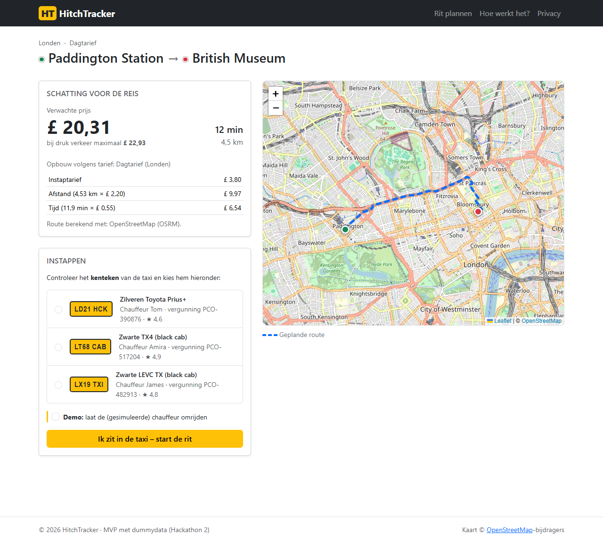
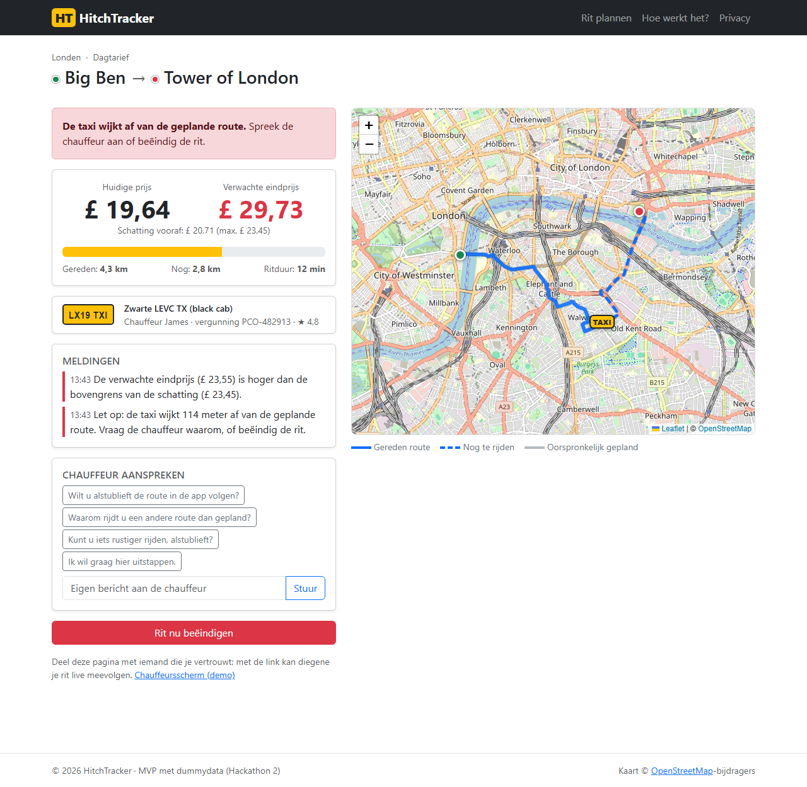
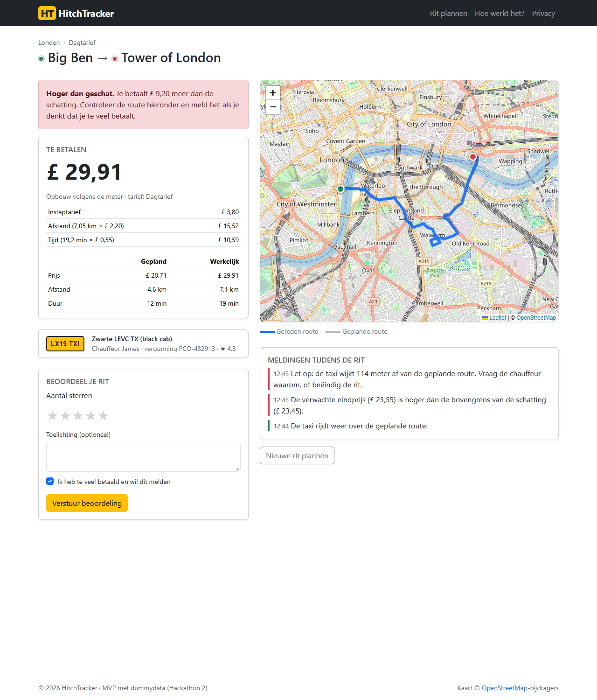

# HitchTracker

> Hackathon 2 – Taxi Hitch Tracker · MVP met dummydata

Je bent in een onbekende stad, neemt een taxi voor wat een kort stukje lijkt – en betaalt ineens € 45.
**HitchTracker** laat de reiziger vooraf zien wat een eerlijke ritprijs is, en tijdens de rit of de chauffeur
de juiste route rijdt en wat de rit gaat kosten.

| Voor de reis (epic 1) | Tijdens de reis (epic 2) | Na de reis (epic 3) |
|---|---|---|
|  |  |  |
| Bestemming kiezen → reistijd en prijs volgens het officiële tarief | Gereden route, nog te rijden route, huidige prijs, verwachte eindprijs en waarschuwingen | Eindprijs met opbouw, vergelijking met de schatting, beoordelen en melden |

## Functionaliteit

- **Prijsschatting vooraf**: kies een bekende plek of klik op de kaart; de route wordt berekend via OpenStreetMap (OSRM) en geprijsd met het dag- of nachttarief van de stad (Londen, Amsterdam, Parijs).
- **Live volgen**: kaart met gereden route (doorgetrokken), nog te rijden route (gestippeld) en de oorspronkelijk geplande route; meterstand en verwachte eindprijs worden elke 2 seconden bijgewerkt.
- **Waarschuwingen**: zodra de taxi meer dan 100 m van de route afwijkt, of de verwachte eindprijs boven de bovengrens van de schatting komt.
- **Chauffeur aanspreken**: standaardberichten (handig zonder gemeenschappelijke taal) of een eigen bericht, zichtbaar op het chauffeursscherm.
- **Rit voortijdig beëindigen**: je betaalt de meterstand op dat moment.
- **Eindprijs**: opbouw volgens de meter, gepland versus werkelijk, oordeel "eerlijke prijs" of "hoger dan geschat", beoordeling en melding van te veel betalen.
- **Privacy by design**: geen account en geen persoonsgegevens van reizigers; locatiegegevens worden automatisch verwijderd na 30 dagen.

Omdat er in het MVP geen echte taxi's rijden, rijdt een **simulator** de taxi (10× versneld). Met de demo-optie
*"laat de chauffeur omrijden"* zie je de waarschuwingen in actie.

## Snel starten

Vereist: [.NET 10 SDK](https://dotnet.microsoft.com/download).

```bash
git clone https://github.com/StijnR7/hackathon2.git
cd hackathon2
dotnet run --project src/HitchTracker.Web --launch-profile http
```

Open daarna <http://localhost:5189>. De SQLite-database (`hitchtracker.db`) wordt bij de eerste start automatisch
aangemaakt en gevuld met dummydata. Zonder internet werkt de app ook: dan gebruikt hij een offline routebenadering
(de kaartachtergrond is dan niet zichtbaar).

### Tests uitvoeren

```bash
dotnet test
```

87 geautomatiseerde tests: unittests (rekenwerk, tarieven, routebewaking, bedrijfslogica tegen een echte SQLite-database)
en integratietests (de complete webapplicatie via HTTP). Zie het [testrapport](docs/07-testrapport.md).

## Documentatie

| Document | Inhoud |
|---|---|
| [01 – Plan van aanpak en planning](docs/01-plan-van-aanpak.md) | Opdracht, doelen, afbakening, MoSCoW, planning van 3 weken, risico's |
| [02 – Functioneel ontwerp](docs/02-functioneel-ontwerp.md) | User stories met acceptatiecriteria, use-casediagram, wireframes, navigatie, concurrentieanalyse |
| [03 – Technisch ontwerp](docs/03-technisch-ontwerp.md) | Architectuur, klassendiagram, ERD, activiteiten-, sequentie- en toestandsdiagram, keuzes, privacy/ethiek/security |
| [04 – Systeemdocumentatie](docs/04-systeemdocumentatie.md) | Installatie, configuratie, projectstructuur, API, codeconventies, versiebeheer |
| [05 – Gebruikershandleiding](docs/05-gebruikershandleiding.md) | Stap voor stap een rit plannen, volgen en afrekenen |
| [06 – Testplan](docs/06-testplan.md) | Testaanpak (TMap/ISTQB), testsoorten, testgevallen |
| [07 – Testrapport](docs/07-testrapport.md) | Resultaten van unit-, integratie- en acceptatietests met conclusies |
| [08 – Verbetervoorstellen](docs/08-verbetervoorstellen.md) | Verbetervoorstellen uit tests en review, met planning |
| [09 – Logboek](docs/09-logboek.md) | Voortgang en afwijkingen van de planning |
| [10 – Script productvideo](docs/10-videoscript.md) | Draaiboek voor de video waarin het product wordt uitgelegd |

## Techniek

ASP.NET Core 10 MVC · Entity Framework Core 10 (SQLite, migraties) · Leaflet 1.9.4 + OpenStreetMap · OSRM-routeplanner · Bootstrap 5 · xUnit

```
src/HitchTracker.Web/      webapplicatie (Controllers, Models, Services, Views, wwwroot)
tests/HitchTracker.Tests/  unit- en integratietests
docs/                      ontwerp, test- en projectdocumentatie
```

## Dummydata

Steden, tarieven, plaatsen, chauffeurs en taxi's zijn verzonnen of benaderd (zie `Data/DbSeeder.cs`) en zijn
**niet** de officiële tarieven. De demo-API-sleutels van de taxi's staan in de [systeemdocumentatie](docs/04-systeemdocumentatie.md#taxi-api).
