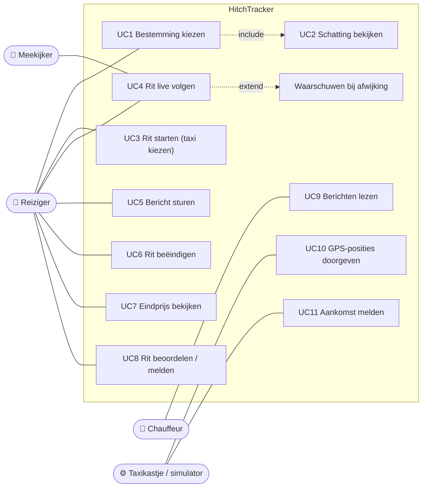
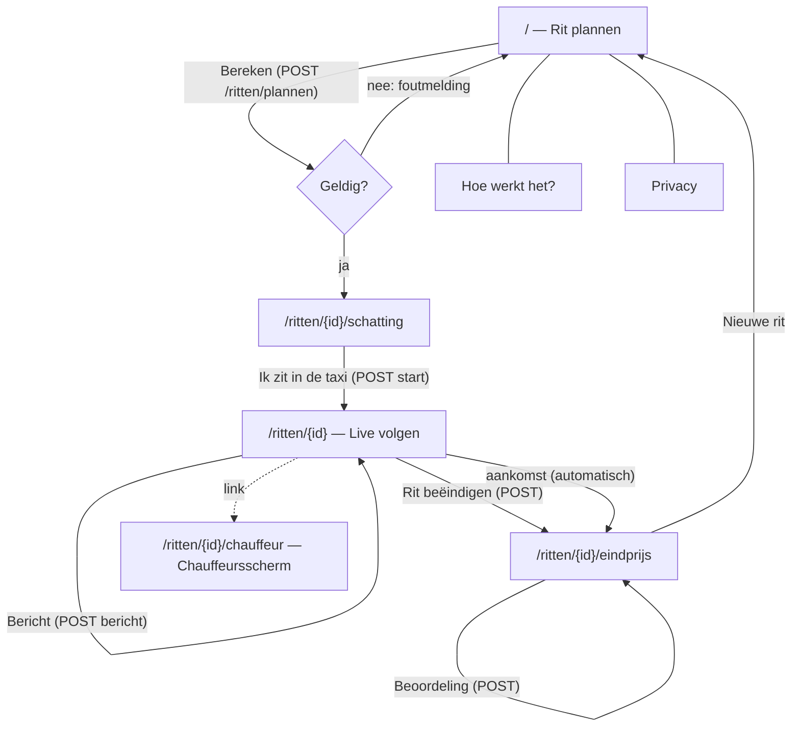

# 02 – Functioneel ontwerp

**Werkproces:** B1-K1-W2 Maakt een technisch ontwerp voor software (functioneel deel)

## 1. Doelgroep en context

- **Reiziger (primair):** toerist in een onbekende stad, spreekt vaak de lokale taal niet, kent de prijzen en de weg niet. Gebruikt de telefoon in de taxi, vaak onder lichte stress (onbekende omgeving, avond).
- **Chauffeur:** ziet berichten van de reiziger op een scherm in de taxi; het taxikastje stuurt GPS-posities door.
- **Medemens (vriend/familie):** volgt via een gedeelde link mee (veiligheid).
- **Beheerder (later):** beheert steden, tarieven en klachten. Valt buiten het MVP (gegevens via seed-data).

## 2. User stories en acceptatiecriteria

Afgeleid van de drie epics van de opdrachtgever. Prioriteit volgens MoSCoW (zie [plan van aanpak](01-plan-van-aanpak.md#4-prioritering-moscow)).

### Epic 1 – Voor de reis

**US-01 Bestemming kiezen (Must)** – Als reiziger wil ik een ophaallocatie en bestemming kiezen uit bekende plekken of op de kaart, zodat ik geen adres in een vreemde taal hoef te typen.
- AC1 Ik kan een stad kiezen; de kaart en de lijst met plekken passen zich aan.
- AC2 Ik kan een plek uit de lijst kiezen óf op de kaart klikken.
- AC3 Zonder ophaallocatie of bestemming krijg ik een duidelijke foutmelding.
- AC4 Een punt buiten het werkgebied van de stad of te dicht bij de ophaallocatie (< 200 m) wordt geweigerd met uitleg.

**US-02 Schatting van reistijd en prijs (Must)** – Als reiziger wil ik vóór het instappen de reistijd en de prijs zien, zodat ik weet wat een eerlijke prijs is.
- AC1 Ik zie de afstand, de reistijd en de verwachte prijs in de lokale valuta.
- AC2 Ik zie een bovengrens voor druk verkeer.
- AC3 Ik zie de opbouw van de prijs (instaptarief, afstand, tijd, eventueel minimumtarief).
- AC4 De route staat op de kaart.

**US-03 Officieel tarief per stad en tijdstip (Should)** – Als reiziger wil ik dat de schatting het tarief van de stad op dat moment gebruikt (dag/nacht), zodat de schatting klopt.
- AC1 Het tarief wordt gekozen op basis van de **lokale** tijd van de stad.
- AC2 De naam van het gebruikte tarief staat bij de schatting.
- AC3 Een tariefwijziging tijdens de rit verandert de prijs van een lopende rit niet.

### Epic 2 – Tijdens de reis

**US-04 Gereden en nog te rijden route (Must)** – Als reiziger wil ik op de kaart de gereden route en de nog te rijden route zien, zodat ik zie of de chauffeur de goede kant op rijdt.
- AC1 Gereden route = doorgetrokken lijn, nog te rijden route = gestippelde lijn, oorspronkelijke route = grijs.
- AC2 De positie van de taxi wordt minimaal elke 2 seconden bijgewerkt zonder de pagina te verversen.
- AC3 Ik zie gereden afstand, resterende afstand, ritduur en een voortgangsbalk.

**US-05 Huidige en verwachte eindprijs (Must)** – Als reiziger wil ik de huidige prijs en de verwachte eindprijs zien, zodat ik niet voor verrassingen kom te staan.
- AC1 De huidige prijs = meterstand volgens tarief (instap + km + minuten).
- AC2 De verwachte eindprijs = huidige prijs + kosten van de resterende route.
- AC3 De schatting van vooraf blijft zichtbaar ter vergelijking.

**US-06 Waarschuwing bij omrijden of te hoge prijs (Should)** – Als reiziger wil ik gewaarschuwd worden als de chauffeur van de route afwijkt of de prijs te hoog wordt, zodat ik op tijd kan ingrijpen.
- AC1 Bij > 100 m afwijking van de geplande route verschijnt een rode melding met de afstand.
- AC2 Als de verwachte eindprijs boven de bovengrens van de schatting komt, verschijnt een melding.
- AC3 Rijdt de taxi weer over de route (< 50 m), dan verschijnt een groene melding.
- AC4 GPS-ruis rond de drempel geeft geen reeks meldingen (hysterese).

**US-07 Rit voortijdig beëindigen (Must)** – Als reiziger wil ik de rit kunnen beëindigen, zodat ik in het ergste geval kan uitstappen en alleen het gereden stuk betaal.
- AC1 Er wordt eerst om bevestiging gevraagd.
- AC2 De eindprijs is de meterstand op dat moment.
- AC3 De rit krijgt de status "voortijdig beëindigd" en de taxi is weer beschikbaar.

**US-08 Chauffeur aanspreken (Should)** – Als reiziger wil ik de chauffeur een bericht sturen, zodat ik de chauffeur kan aanspreken, ook zonder gemeenschappelijke taal.
- AC1 Ik kan kiezen uit standaardberichten of een eigen bericht typen (max. 200 tekens).
- AC2 Een leeg of te lang bericht wordt geweigerd.
- AC3 Het bericht verschijnt direct op het chauffeursscherm.

### Epic 3 – Na de reis

**US-09 Eindprijs met opbouw (Must)** – Als reiziger wil ik de eindprijs zien met de opbouw volgens de meter, zodat ik weet wat ik moet betalen.
- AC1 Na aankomst ga ik automatisch naar de eindprijspagina.
- AC2 Ik zie instaptarief, afstandskosten, tijdkosten en het totaal.

**US-10 Vergelijking met de schatting (Should)** – Als reiziger wil ik zien of de eindprijs binnen de schatting valt, zodat ik weet of ik te veel betaal.
- AC1 Groen "Eerlijke prijs" als de eindprijs ≤ bovengrens; rood "Hoger dan geschat" met het verschil als hij erboven ligt.
- AC2 Tabel gepland vs. werkelijk (prijs, afstand, duur) en beide routes op de kaart.

**US-11 Beoordelen en te veel betalen melden (Should)** – Als reiziger wil ik de rit beoordelen en melden als ik te veel betaal, zodat de chauffeur hierop aangesproken kan worden.
- AC1 1–5 sterren, optionele toelichting (max. 500 tekens), vinkje "te veel betaald" (staat al aan als de prijs te hoog was).
- AC2 Een rit kan maar één keer beoordeeld worden, en pas na afloop.

### Overig

**US-12 Chauffeursscherm (Could)** – Als chauffeur wil ik berichten van de reiziger en de verwachte route zien, zodat ik weet wat de reiziger verwacht.

**US-13 Rit delen (Could)** – Als reiziger wil ik de link van mijn rit delen, zodat iemand die ik vertrouw kan meekijken.

### Niet-functionele eisen

| Code | Eis |
|---|---|
| NF-01 | Werkt in een mobiele browser (vanaf 360 px breed) en op een tabletscherm in de taxi. |
| NF-02 | Geen account nodig; er worden geen persoonsgegevens van reizigers opgeslagen. |
| NF-03 | Locatiegegevens worden maximaal 30 dagen na de rit bewaard, ritten maximaal 90 dagen. |
| NF-04 | Bescherming tegen XSS, CSRF, clickjacking; beveiligingsheaders; rate limiting op routeberekening. |
| NF-05 | Bij uitval van de routeplanner krijgt de reiziger nog steeds een (benaderde) schatting. |
| NF-06 | Status wordt binnen 2 seconden bijgewerkt; bij verbindingsverlies wordt automatisch opnieuw geprobeerd. |
| NF-07 | Toegankelijk: labels bij velden, kleur niet als enige informatiedrager (tekst bij meldingen), toetsenbordbediening. |

## 3. Use-casediagram



## 4. Wireframes (mobiel, lo-fi)

De wireframes zijn mobile-first gemaakt; op een groot scherm staat de kaart rechts naast de inhoud.
Het uiteindelijke ontwerp staat in de [gebruikershandleiding](05-gebruikershandleiding.md).

```
┌─ 1. Rit plannen ──────────┐  ┌─ 2. Schatting ────────────┐  ┌─ 3. Live volgen ──────────┐  ┌─ 4. Eindprijs ────────────┐
│ [HT] HitchTracker     [≡] │  │ Big Ben → Tower of London │  │ Big Ben → Tower of London │  │ Big Ben → Tower of London │
│ Waar wil je heen?         │  │ ┌───────────────────────┐ │  │ ┌───────────────────────┐ │  │ ┌───────────────────────┐ │
│ Stad      [Londen      ▼] │  │ │  Verwachte prijs      │ │  │ │ ███ KAART ███  TAXI   │ │  │ │ ✓ Eerlijke prijs /    │ │
│ ● Ophalen [Big Ben     ▼] │  │ │  £ 20,71    12 min    │ │  │ │ ━━ gereden  ┅┅ nog    │ │  │ │ ✗ Hoger dan geschat   │ │
│ ● Naar    [Tower       ▼] │  │ │  max £ 23,45  4,6 km  │ │  │ └───────────────────────┘ │  │ └───────────────────────┘ │
│ Klik zet: (Ophalen)(Naar) │  │ │  instap / km / min    │ │  │ ⚠ Taxi wijkt af van route │  │ Te betalen   £ 29,91      │
│ ┌───────────────────────┐ │  │ └───────────────────────┘ │  │ Huidig £14,00 Verwacht £25│  │ instap / km / min         │
│ │                       │ │  │ ┌───────────────────────┐ │  │ [█████░░░░░] 2,8 / 3,2 km │  │ Gepland | Werkelijk       │
│ │   KAART met plekken   │ │  │ │ KAART met route       │ │  │ [LX19 TXI] James PCO-…    │  │ ┌───────────────────────┐ │
│ │                       │ │  │ └───────────────────────┘ │  │ Meldingen                 │  │ │ KAART gepland/gereden │ │
│ └───────────────────────┘ │  │ Kies je taxi (kenteken):  │  │ [Volg de route] [Waarom?] │  │ └───────────────────────┘ │
│ [ Bereken reistijd/prijs ]│  │ (•) [LX19 TXI] James ★4,8 │  │ [eigen bericht…  ][Stuur] │  │ ★★★★☆  [toelichting]      │
│                           │  │ ( ) [LT68 CAB] Amira ★4,9 │  │ [   Rit nu beëindigen   ] │  │ ☑ te veel betaald melden  │
│ 1 voor · 2 tijdens · 3 na │  │ [ Ik zit in de taxi ]     │  │ Deel link · chauffeur     │  │ [ Verstuur beoordeling ]  │
└───────────────────────────┘  └───────────────────────────┘  └───────────────────────────┘  └───────────────────────────┘
```

**Ontwerpkeuzes in de wireframes**

- **Grote bedragen bovenaan:** de prijs is de kern van het probleem; in één oogopslag zichtbaar, ook in een rijdende taxi.
- **Kaart + lijst:** toeristen kennen de adressen niet; bekende plekken (stations, bezienswaardigheden) en klikken op de kaart werken zonder typen.
- **Kenteken als "kentekenplaat":** de reiziger controleert of hij in de juiste taxi zit (veiligheid).
- **Standaardberichten:** ook zonder gemeenschappelijke taal kan de reiziger de chauffeur aanspreken.
- **Rode/groene meldingen mét tekst:** kleur is niet de enige informatiedrager (toegankelijkheid).
- **Eén rode knop "Rit nu beëindigen" met bevestiging:** altijd bereikbaar, maar niet per ongeluk in te drukken.

## 5. Navigatie (schermstroom)



Een rit-URL leidt altijd naar de pagina die bij de status hoort (gepland → schatting, onderweg → live, afgelopen → eindprijs),
zodat een gedeelde of oude link nooit een verkeerde stap toont.

## 6. Concurrentieanalyse

De opdrachtgever weet dat er concurrenten zijn. Wat doen zij goed en wat niet?

| | Uber / Bolt | FREENOW | Google Maps "rit delen" | Gewone straattaxi | **HitchTracker** |
|---|---|---|---|---|---|
| Prijs vooraf | Vaste prijs (met surge pricing) | Schatting | – | Nee | **Schatting met bandbreedte volgens officieel tarief** |
| Werkt met straattaxi's (meter) | Nee, eigen platform | Deels | Ja (alleen locatie) | – | **Ja** |
| Live route t.o.v. verwachte route | Route ja, afwijking nee | Route ja | Alleen positie | Nee | **Ja, met waarschuwing bij afwijking** |
| Verwachte eindprijs tijdens rit | Nee (vaste prijs) | Nee | Nee | Nee | **Ja** |
| Account verplicht | Ja (incl. betaalgegevens) | Ja | Google-account | – | **Nee** |
| Rit delen met vertrouwde persoon | Ja | Ja | Ja | Nee | Ja (link) |
| Melden te hoge prijs | Via support | Via support | – | – | **Direct na de rit, met route als bewijs** |

**Conclusie / ons voordeel:** de grote platforms beschermen alleen hun eigen ritten en vragen een account met betaalgegevens.
Wie in het buitenland een **gewone taxi** van de standplaats neemt, heeft niets. HitchTracker richt zich juist op die rit:
zonder account, met het officiële tarief van de stad als maatstaf, en met live controle van route en prijs.
Goede ideeën van concurrenten die we overnemen: rit delen via link, beoordelen na de rit, kenteken en chauffeur tonen.
