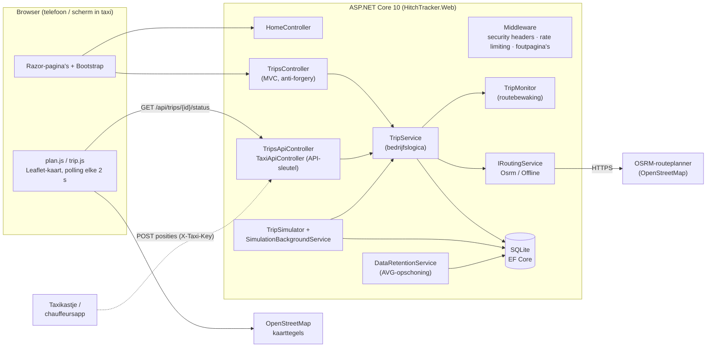
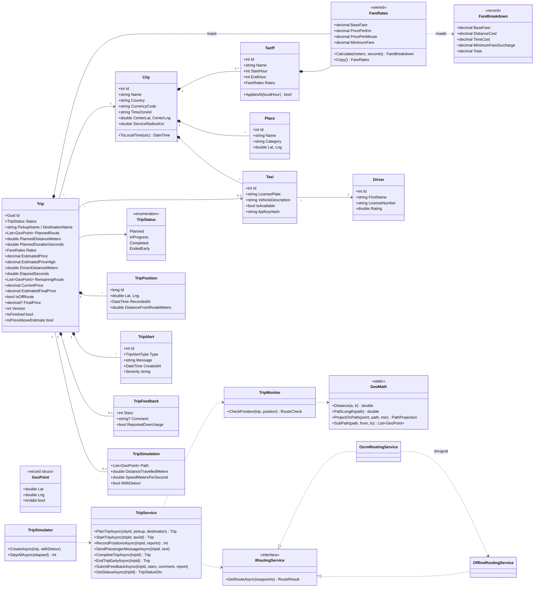
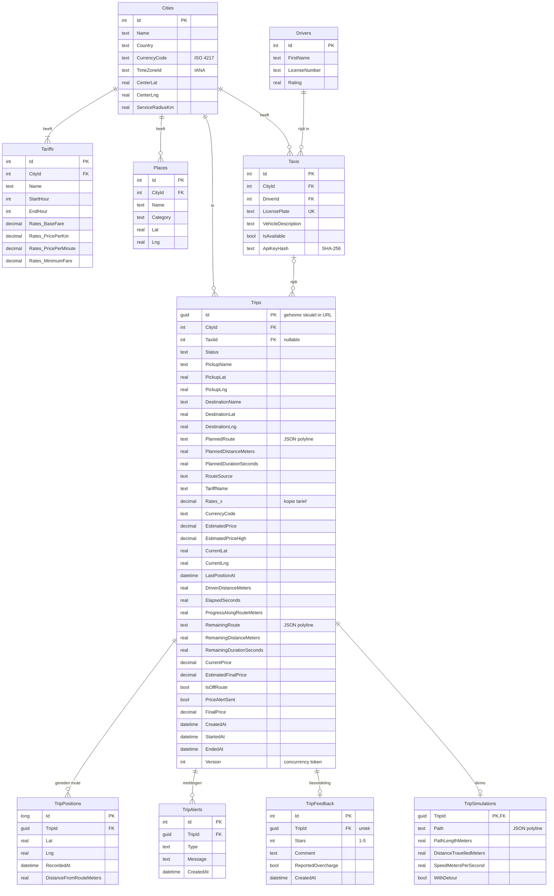
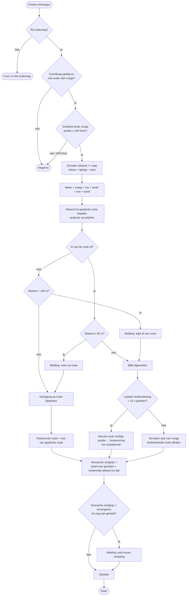
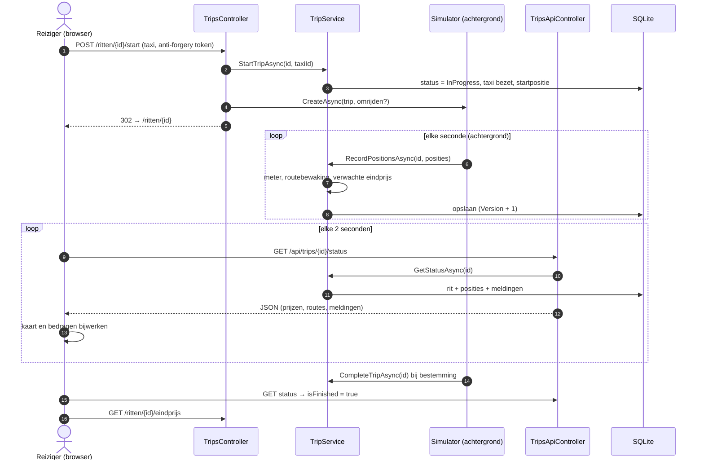
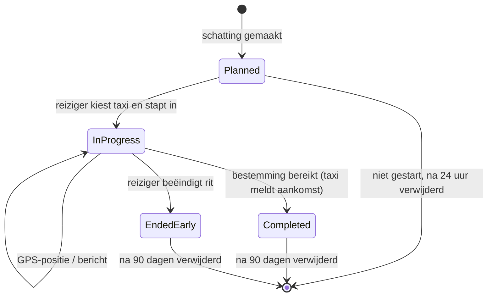

# 03 – Technisch ontwerp

**Werkproces:** B1-K1-W2 Maakt een technisch ontwerp voor software

Dit document vertaalt de [user stories](02-functioneel-ontwerp.md) naar een technisch ontwerp. Gebruikte schematechnieken:
architectuurdiagram, **klassendiagram**, **ERD**, **activiteitendiagram**, **sequentiediagram**, **toestandsdiagram**
(en in het functioneel ontwerp: use-casediagram en navigatiestroom). Alle diagrammen zijn in Mermaid geschreven, zodat
ze in GitHub worden weergegeven en onder versiebeheer staan.

## 1. Architectuur



**Lagen.** Controllers zijn dun: ze valideren invoer, roepen een service aan en kiezen een view. Alle regels
(prijs, status-overgangen, routebewaking) zitten in `Services` en `Models`, zodat ze los te testen zijn. De
simulator gebruikt **exact dezelfde** methode (`TripService.RecordPositionsAsync`) als de API voor een echt
taxikastje; de simulatie kan dus later zonder wijzigingen in de rest van het systeem vervangen worden.

## 2. Klassendiagram



## 3. Datamodel (ERD)



**Keuzes in het datamodel**

- **Tarief wordt gekopieerd naar de rit** (`Rates_*` in `Trips`): wijzigt de stad haar tarief, dan verandert de prijs van een lopende rit niet (US-03 AC3).
- **Routes als JSON-polyline** in één kolom: een route wordt altijd als geheel gelezen en geschreven; een aparte tabel met duizenden punten zou alleen vertragen. De **gereden** route staat wél per punt in `TripPositions`, omdat die stap voor stap groeit en na 30 dagen apart verwijderd moet kunnen worden.
- **GUID als sleutel** van een rit: onvoorspelbaar (122 bits willekeur), zodat niemand ritten van anderen kan raden; geen account nodig.
- **Geen reizigerstabel**: er zijn geen persoonsgegevens van reizigers (privacy by design).
- **`ON DELETE CASCADE`** van rit naar posities, meldingen, beoordeling en simulatie: de opschoonservice verwijdert een rit in één keer volledig.
- **`Version`** als concurrency token: de simulator en de reiziger kunnen tegelijk dezelfde rit wijzigen (zie §5).

## 4. Activiteitendiagram – verwerken van een GPS-positie

Dit is de kern van epic 2: wat gebeurt er als het taxikastje (of de simulator) een positie doorgeeft?



## 5. Sequentiediagram – live volgen



**Gelijktijdigheid.** Als de reiziger op "Rit beëindigen" drukt terwijl de simulator net een positie opslaat,
voorkomt het concurrency token (`Version`) dat de ene wijziging de andere overschrijft: de tweede schrijver krijgt
een `DbUpdateConcurrencyException`. `TripService` leest de rit dan opnieuw in en probeert het nog eens (max. 3×);
de simulator slaat de tick over.

## 6. Toestandsdiagram – status van een rit



Elke actie controleert de huidige status; een ongeldige overgang (bijv. een afgeronde rit opnieuw starten of
twee keer beoordelen) geeft een nette melding (`TripStateException`) in plaats van een fout.

## 7. Algoritmes

**Ritprijs** (zelfde formule voor schatting, meter en verwachte eindprijs):

```
prijs = max(minimumtarief, instaptarief + afrond(km × prijs per km) + afrond(minuten × prijs per minuut))
```

- *Schatting* = formule over de route-afstand en de verwachte rijtijd van de routeplanner.
- *Bovengrens* = zelfde afstand, rijtijd × 1,4 (druk verkeer). Instelbaar (`Monitoring:TrafficMarginFactor`).
- *Meter* = formule over de gereden afstand (som van GPS-stappen) en de verstreken tijd.
- *Verwachte eindprijs* = formule over (gereden + resterende afstand) en (verstreken + resterende tijd).

Omdat de schatting en de meter dezelfde afstandsmaat gebruiken (lengte van de polyline), betaalt de reiziger bij het
rijden van de geplande route precies de geschatte prijs (getest in UT-47 en UT-51).

**Afwijking van de route:** de positie wordt loodrecht geprojecteerd op elk lijnstuk van de geplande route
(lokale vlakke projectie, nauwkeurig genoeg binnen een stad); de kleinste afstand telt. Stukken die al verreden zijn
(meer dan 200 m terug) worden overgeslagen, zodat een route die vlak langs zichzelf terugloopt geen sprong in de
voortgang geeft. Drempel 100 m met **hysterese** (terug op route pas onder 50 m) tegen GPS-ruis.

## 8. Technische keuzes en onderbouwing

| Keuze | Alternatieven | Waarom deze keuze |
|---|---|---|
| **Webapplicatie (responsive)** i.p.v. native app | Native iOS/Android, MAUI | De toerist hoeft in het buitenland niets te installeren (dure roaming, geen app-store-account nodig); dezelfde pagina werkt op telefoon én scherm in de taxi; link delen werkt direct. |
| **ASP.NET Core 10 MVC (C#)** | Node.js, PHP/Laravel | Aanbevolen in de casus (EF Core-hulpbron), sterke typering, ingebouwde anti-forgery, validatie, rate limiting en DI; .NET 10 is een LTS-versie (ondersteund tot 2028). |
| **Entity Framework Core + migraties** | Dapper, ruwe SQL | Databaseschema onder versiebeheer (migraties), geparametriseerde queries (geen SQL-injectie), LINQ is goed leesbaar. |
| **SQLite** | SQL Server, PostgreSQL | Geen databaseserver nodig: de app start met één commando, ideaal voor een MVP en voor tests (in-memory). Via EF Core later eenvoudig te vervangen door PostgreSQL/SQL Server. |
| **Leaflet + OpenStreetMap** | Google Maps, Mapbox | Open source, geen API-sleutel of creditcard, geen tracking van gebruikers door een advertentiebedrijf (privacy). Leaflet staat lokaal in `wwwroot/lib`, geen CDN. |
| **OSRM-routeplanner + offline terugval** | Google Directions API | Gratis, OpenStreetMap-data, geeft afstand + rijtijd + route. Interface `IRoutingService` maakt vervangen eenvoudig; bij uitval wordt de offline benadering gebruikt (NF-05). |
| **Polling elke 2 s** | SignalR/WebSockets | Eenvoudig, werkt door elke proxy en bij wisselend mobiel bereik (automatisch opnieuw proberen); 2 s is ruim voldoende voor een taxi. SignalR staat als verbetervoorstel. |
| **Simulator via dezelfde service als de echte API** | Nepdata in de views | Het MVP test zo de echte keten (positie → meter → waarschuwing → scherm). De taxikastje-API (`/api/taxi/...`) is al gebouwd en getest. |
| **Geen account, GUID-link** | Inloggen met e-mail | Minder drempel voor toeristen, geen persoonsgegevens (AVG), rit delen is gewoon de link doorsturen. |
| **xUnit + WebApplicationFactory** | MSTest, Selenium | Unittests en integratietests in één project; de integratietests draaien de complete app in het geheugen zonder browser of internet. |

## 9. Privacy, ethiek en security

### Privacy (AVG)

| Principe | Uitwerking in het ontwerp |
|---|---|
| Dataminimalisatie | Geen naam, e-mail, telefoon of betaalgegevens van de reiziger. Van de chauffeur alleen voornaam + vergunningnummer (nodig om te herkennen en te melden). |
| Doelbinding | Locatiegegevens alleen voor route, prijs en bewijs bij klachten; nooit buiten een rit. |
| Opslagbeperking | `DataRetentionService` verwijdert automatisch: posities na 30 dagen, ritten na 90 dagen, ongebruikte schattingen na 24 uur (instelbaar). |
| Transparantie | Privacypagina in de app met per gegeven het doel en de bewaartermijn. |
| Derden | Routeplanner krijgt alleen begin- en eindpunt, geen gegevens over de persoon. `Referrer-Policy: strict-origin-when-cross-origin` voorkomt dat de geheime rit-link via kaarttegels naar OpenStreetMap lekt. |
| Logging | Logs bevatten rit-ID's en afstanden, geen coördinaten of berichten. |

### Ethiek

- **Eerlijk tegenover de chauffeur:** een afwijking is niet automatisch fraude (wegwerkzaamheden, afsluiting). De app formuleert daarom neutraal ("Vraag de chauffeur waarom") en de chauffeur ziet op het eigen scherm ook dat de taxi afwijkt. Beoordelingen zijn gekoppeld aan een echte rit, zodat er geen nepbeoordelingen gegeven kunnen worden.
- **Geen schijnzekerheid:** de schatting is een bandbreedte (normaal – druk verkeer) en de tarieven zijn duidelijk als dummydata gemarkeerd.
- **Toegankelijkheid:** labels, tekst bij elke kleur, bediening met toetsenbord, `aria-live` voor nieuwe meldingen.
- **Veiligheid boven alles:** voortijdig beëindigen is altijd met één knop (plus bevestiging) mogelijk; rit delen met een vertrouwd persoon.

### Security (OWASP Top 10)

| Risico | Maatregel |
|---|---|
| Injectie (SQL) | Alleen EF Core met geparametriseerde queries. |
| XSS | Razor encodeert alle uitvoer; JavaScript gebruikt `textContent`, nooit `innerHTML` voor berichten; strikte **Content-Security-Policy** (`script-src 'self'`, geen inline scripts). Getest in IT-07. |
| CSRF | Alle wijzigende acties zijn POST met `[ValidateAntiForgeryToken]`. Getest in IT-03. |
| Broken access control | Rit-ID is een onvoorspelbare GUID; de taxi-API vereist de API-sleutel **van de taxi die de rit rijdt**. Getest in IT-09. |
| Gevoelige gegevens | API-sleutels alleen als SHA-256-hash opgeslagen en in constante tijd vergeleken; HTTPS + HSTS in productie. |
| Misbruik / DoS | Rate limiting: max. 20 routeberekeningen per minuut per IP-adres; maximaal 500 posities per API-aanroep. |
| Clickjacking | `X-Frame-Options: DENY` en `frame-ancestors 'none'`. |
| Invoervalidatie | Data-annotaties + servervalidatie: coördinaten binnen bereik en binnen het werkgebied, berichtlengte, sterren 1–5, onrealistische GPS-sprongen worden genegeerd. |
| Foutafhandeling | Nette foutpagina's (404/429/500) zonder stacktrace; domeinfouten worden vertaald naar begrijpelijke meldingen. |

## 10. Controle: ontwerp t.o.v. eisen

| Eis | Waar in het ontwerp |
|---|---|
| E1 schatting reistijd en kosten | `TripService.PlanTripAsync`, `FareRates`, `TariffSelector`, schattingspagina |
| E2 gereden route / nog te rijden route | `TripPositions`, `RemainingRoute`, activiteitendiagram §4, live pagina |
| E2 huidige prijs / schatting eindprijs | `CurrentPrice`, `EstimatedFinalPrice`, §7 |
| E2 chauffeur aanspreken / voortijdig beëindigen | `SendPassengerMessageAsync`, `EndTripEarlyAsync`, toestandsdiagram |
| E3 eindprijs, niet te veel betalen | `FinalPrice`, vergelijking met `EstimatedPriceHigh`, `TripFeedback.ReportedOvercharge` |
| Privacy, ethiek, veiligheid | §9 |

**Voorstel tot aanpassing (na review van het ontwerp):** de oorspronkelijke opzet had één vaste schatting. Omdat
verkeer de rijtijd sterk beïnvloedt, is een **bandbreedte** toegevoegd (bovengrens bij druk verkeer); de waarschuwing
gaat pas af boven die bovengrens, zodat de reiziger niet bij elke file een onterechte melding krijgt.

**Akkoord leidinggevende op het ontwerp**

| Naam | Datum | Handtekening |
|---|---|---|
| | | |
