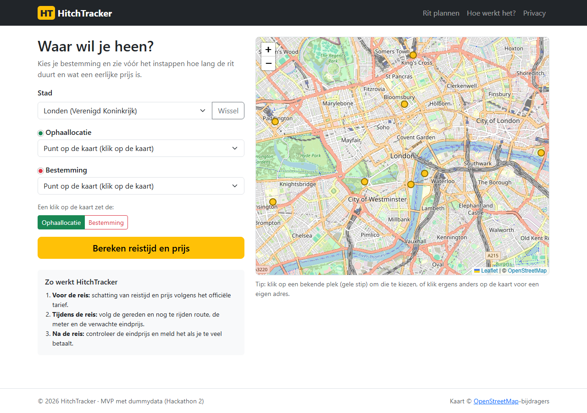
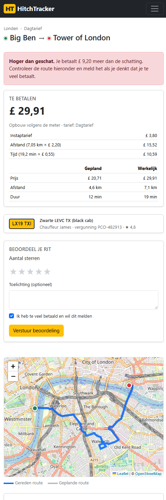
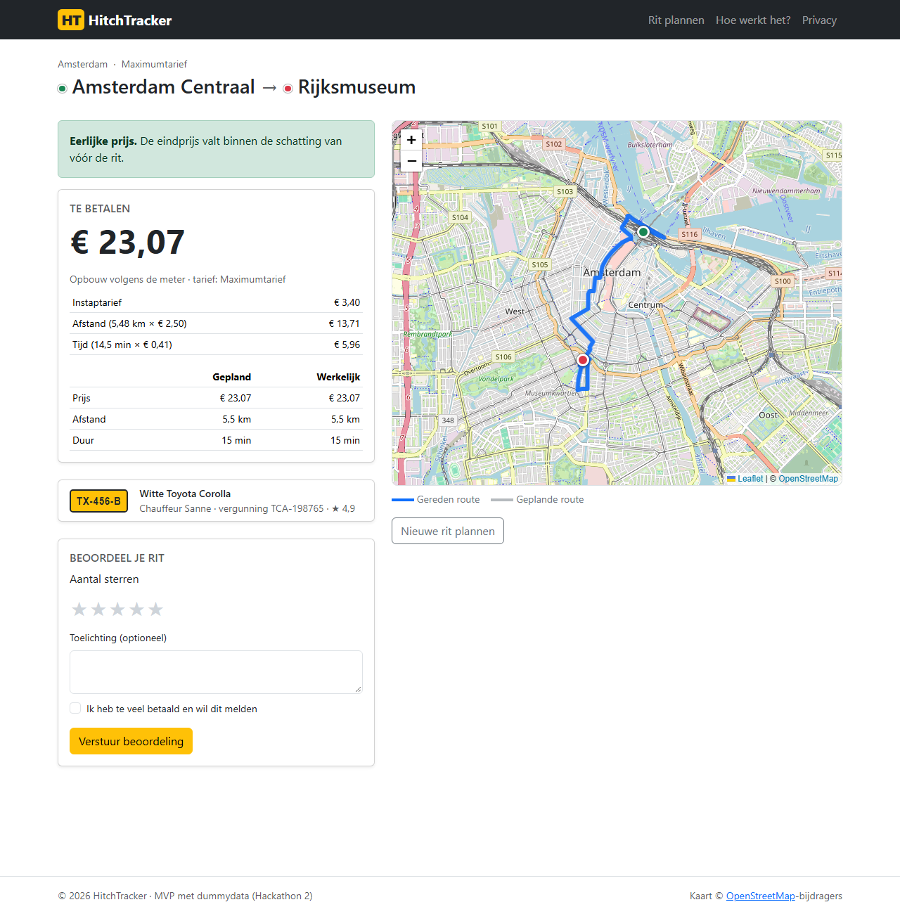
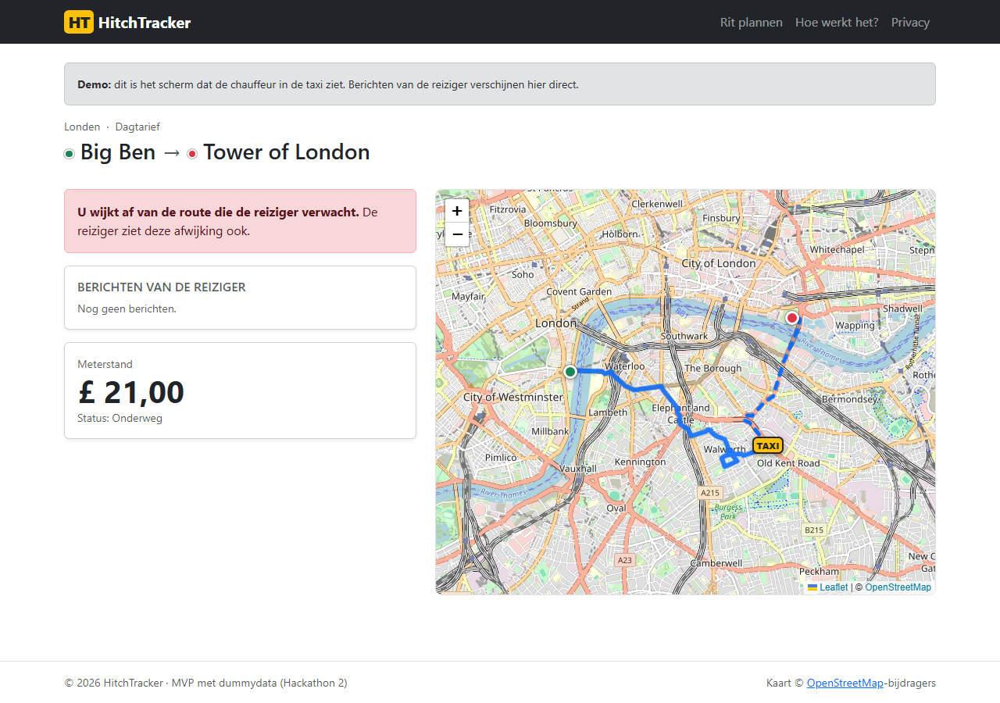

# 05 – Gebruikershandleiding

HitchTracker helpt je om in een onbekende stad niet te veel te betalen voor een taxi. Je hebt geen account nodig.

## Stap 1 – Rit plannen

1. Kies de **stad** (Londen, Amsterdam of Parijs). De kaart springt naar die stad.
2. Kies de **ophaallocatie**: een bekende plek uit de lijst, of klik op de kaart (de gele stippen zijn bekende plekken).
3. Kies de **bestemming** op dezelfde manier. Na het kiezen van de ophaallocatie staat de kaartklik automatisch op "Bestemming".
4. Klik op **Bereken reistijd en prijs**.

Krijg je een melding? Dan ontbreekt er een locatie, ligt een punt buiten het werkgebied van de stad, of liggen de punten te dicht bij elkaar.

## Stap 2 – Schatting bekijken en instappen

- Je ziet de **verwachte prijs**, de prijs **bij druk verkeer** (bovengrens), de reistijd, de afstand en de opbouw volgens het officiële tarief van de stad (dag- of nachttarief).
- De route staat op de kaart.
- Stap je in? Controleer het **kenteken** van de taxi, kies hem in de lijst en klik op **Ik zit in de taxi – start de rit**.
- *Demo-optie:* vink "laat de (gesimuleerde) chauffeur omrijden" aan om te zien wat er gebeurt als een chauffeur omrijdt.

## Stap 3 – Rit live volgen

- **Kaart:** blauwe doorgetrokken lijn = gereden route, blauwe stippellijn = nog te rijden, grijs = de route die oorspronkelijk gepland was. Het gele "TAXI"-label is de taxi.
- **Huidige prijs** = wat de meter nu aangeeft. **Verwachte eindprijs** = wat je bij aankomst ongeveer betaalt. Wordt de verwachte eindprijs rood, dan ligt hij boven de bovengrens van de schatting.
- **Meldingen:** je krijgt een rode melding als de taxi meer dan 100 meter van de route afwijkt of als de prijs te hoog dreigt te worden.
- **Chauffeur aanspreken:** tik op een standaardbericht (bijv. "Wilt u alstublieft de route in de app volgen?") of typ een eigen bericht. Het bericht verschijnt op het scherm van de chauffeur, in de taal van de app.
- **Rit nu beëindigen:** in het ergste geval stop je de rit. Na bevestiging betaal je de meterstand van dat moment.
- **Delen:** stuur de link van deze pagina naar iemand die je vertrouwt; die kan je rit dan live meevolgen.

Op een telefoon staan de onderdelen onder elkaar (hier de eindprijspagina; op de live pagina staat de kaart bovenaan):

## Stap 4 – Eindprijs

| Eerlijke prijs | Hoger dan geschat |
|---|---|
|  |  |

- Bij aankomst ga je automatisch naar de eindprijs.
- Je ziet wat je moet betalen, met de opbouw (instaptarief, afstand, tijd) en een vergelijking **gepland ↔ werkelijk**.
- Groen = de prijs valt binnen de schatting. Rood = je betaalt meer dan geschat; de kaart laat zien waar de taxi is omgereden.
- **Beoordeel je rit** met 1–5 sterren. Heb je te veel betaald, vink dan "Ik heb te veel betaald en wil dit melden" aan (staat al aan als de prijs te hoog was).

## Chauffeursscherm (demo)

Via de link onderaan de live pagina zie je wat de chauffeur in de taxi ziet: de route die de reiziger verwacht, de meterstand en de berichten van de reiziger.

## Veelgestelde vragen

**Moet ik betalen via de app?** Nee, je betaalt de chauffeur zoals altijd. HitchTracker laat zien wat een eerlijk bedrag is.

**Welke gegevens worden bewaard?** Zie de pagina *Privacy* in de app. Kort: geen persoonsgegevens; de gereden route wordt na 30 dagen verwijderd, de rit na 90 dagen.

**Waarom zie ik geen kaart?** De kaart komt van OpenStreetMap en heeft internet nodig. De prijsberekening werkt ook zonder.

**De tarieven kloppen niet met het echte tarief?** Klopt: dit is een demo met dummydata.
